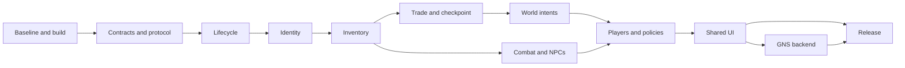

# KenshiCoop: change map and integration plan

Research date: November 1, 2026. Status: research and planning; no integration branch or combined DLL has been produced.

Fork: [Plesen-C/KenshiCoop](https://github.com/Plesen-C/KenshiCoop), upstream: [nhoral/KenshiCoop](https://github.com/nhoral/KenshiCoop). The current `main` retains upstream runtime code and publishes this plan and its research maps. Savas07 is the proposed basis for future integration; its code has not yet been imported.

## Recommended approach

Use **Savas07/KenshiCoop `58514ea33538fca78e932abf44bb658d4e915236`** as the integration base. It retains the original v100/ENet plugin architecture and already includes multiplayer topology, persistent squad ownership, character creation, trading fixes and save fixes. This choice reduces simultaneous architectural changes; it does not establish gameplay stability.

Integrate by functional group while preserving authorship and provenance. Donor protocols, transports and economy rules are incompatible. Select one implementation of each shared mechanism, and preserve alternative gameplay rules as explicit campaign policies. Do not import duplicate fixes or simultaneously enable intermediate changes and the later commits that reversed them.

“All changes” means all identified groups in the active continuations selected by the previous monthly search, including their earlier history and substantive additional branches. The other 34 older forks were previously checked by metadata; this plan does not claim a complete source review of them. Compatibility with every third-party mod or game version has not been established.

## Materials and method

- [Original inventory of 43 forks](docs/migration/forks-2026-11-01.md).
- [Consolidated map of all 101 donor groups and their planned handling](docs/migration/change-map.md), [machine-readable map](docs/migration/change-map.json). Groups are organized into 25 areas. The count includes duplicates and alternatives, not 101 independent features.
- [Savas07, ximery4, Wo-o-o and smaller forks](docs/migration/core-changes.md), [data](docs/migration/changes-core.json).
- [Brandon, TokelaCoop and atimal](docs/migration/brandon-tokela-changes.md), [data](docs/migration/changes-tokela.json).
- [kotetsyy, Vep124, Provod and the LRaverdy alternative](docs/migration/detached-changes.md), [data](docs/migration/changes-detached.json).
- [Pinned refs, shared history, matching code patches and trial merges](docs/migration/integration-evidence.json). This records source SHAs, patch-id scope and trial-merge results.

The central research bare repository contains 82 refs: four upstream branches and 78 branches from ten continuations. Stable patch-id comparisons covered 420 distinct non-merge commits on selected tips, scoped to `src`, `scripts`, `third_party`, `tools` and `.github`. This detects exact patch matches within that scope; unmatched commits are not thereby proven semantically unique. Functions and final trees of major continuations were also examined. Provod was inspected through its release source archive because its main branch lacks the complete source tree. Snapshot IDs and the archive hash are recorded in the specialized map.

Donor code was not executed. Checks consisted of source/history inspection, tree comparisons, patch-application checks and `git merge-tree`. The latter wrote objects only into the research bare repository; it did not create an integration branch. Windows/v100 builds, donor tests and gameplay scenarios were not run.

## Deduplication and provenance

| Sources | Finding | Integration action |
|---|---|---|
| nhoral → Savas07 | 73 commits after upstream | Preserve the selected base’s final state; do not replay historical changes and their reversals as simultaneous features |
| kotetsyy ↔ Brandon | Common ancestor `c413ee03ad72ab74ac8445e6584b23537f59e0a7`; 69 shared commits after upstream | Count shared UI/transport/inventory work once; handle the Brandon tail after divergence separately |
| TokelaCoop ↔ atimal | Common ancestor `d03d6005a2bcaa6aa2fe7fde4c7e9f6b74d4acf3`; 72 shared commits after upstream | Count their shared Tokela history once, then inspect both independent tails |
| ximery4 main ↔ Savas07 | Identical SHA `58514ea3` | No separate main-branch import |
| ximery4 transfer branches | `upstream/xfer-fixture-fab` has the same final tree as `xfer-census-source-fab` | One change source; do not import both |
| Older ximery4 trader snapshot | Separate history with no common ancestor with Savas; includes additional diagnostics | Use clean `upstream/*` patches and port unique diagnostics separately |
| Vep124 sync ↔ nhoral | `src/plugin/sync` matches after CRLF normalization | Do not import synchronization twice; inspect UI/browser/admission changes |
| DerpyNewb ↔ nhoral | Its only branch points to the August upstream commit | No new runtime source identified |
| cookingwithsimon | Full diff consists of `.gitignore` and `NOTES.md` | Preserve useful documentation/attribution; no independent runtime component |
| Wo-o-o | Documentation at the tip, four runtime fixes underneath | Port the actual fixes; the earlier documentation-only impression was incomplete |
| captainjoshua77 | Changes are stored in `ci/fix.patch`, not applied to source | Port useful hunks rather than merging the patch file as an implementation |

Stable patch-id found two additional groups with identical **code-scoped** changes under different SHAs: `dca7736`/`94c6318` and `34f3232`/`ae9425a`. The first matches a limited version-related diff, not every document in the commits; the second includes shared host-intent helpers. Details are in the evidence JSON.

## Main conflict matrix

| Area | Concrete difference | Integration decision |
|---|---|---|
| Packet IDs | Brandon: 50 SquadName, 51 FactionRename, 52 FactionName, 53 Jobs. Atimal: 50 ProdIntent, 51 DoorIntent, 52 FurnIntent, 53 BuildIntent, 54 fence, 55 bounty, 56 ModList, 57 StoreAdd. Savas: 52 VendorDelta, 53 VendorCash | Create a unified registry and a new incompatible schema; reassign types and audit every encoder, decoder and dispatcher |
| Wire version | Equal version numbers do not imply equal structures. Provod protocol 66 changes Hello/Welcome/Money/InvItemEntry | Give the combined schema a distinct identity and exact handshake fingerprint; reject foreign builds before state exchange |
| Inventory | Savas ACK/rebase, shared kotetsyy/Brandon conservation, Wo complete/incomplete snapshots, atimal StoreAdd, Provod rich item identity | One transaction/conservation pipeline; no parallel channels adding the same item |
| Item source | Atimal StoreAdd accepts settled gain without paired source loss; ximery fixture fabrication can permit creation from an empty world chest | Preserve the intended scenario, but permit creation only with proven production provenance or a committed transaction. Keep raw bypasses disabled by default |
| Merchant identity | Local trader keys differ between machines; ximery uses descriptions and deferred RELEASE | One merchant identity model with ambiguity checks, session epoch, sender-scoped cleanup and bounded pending operations |
| NPC identity | Captain’s session-lifetime reverse map partially overlaps Savas `canonicalOf_`, which is pruned after 30 seconds | One serial-validated wire/local map with defined lifetime, rekey handling and world-change cleanup |
| Combat | OWN-attacker filtering overlaps; Brandon stuck/unreachable mirrors and Savas engaged-copy guards have different conditions | One damage/report path and one movement/combat state machine; combine predicates without duplicate writers |
| World authority | KenshiDuo/atimal host intents, Savas host production/cell authority and different placed-object owners | Host-authoritative intent → validated commit → replicated result, with idempotency and explicit authorized writers |
| Economy/diplomacy | Shared wallet/faction versus private wallets/relations | Select `shared`/`private` campaign policy before starting; persist mode/schema in saves and handshake. One active handler per responsibility |
| Speed | Different arbitration, per-owner ACK, latest real command and combat caps | Explicit session policy with preserved per-owner sequencing; adopting totals alone loses acknowledgment semantics |
| Player count | Tokela 2, kotetsyy/Brandon 4, Savas 8, Provod host+8 | Configurable capacity with audited masks/ACK/fanout. Validate 2/4/8 first, then nine total separately |
| Transport/UI | ENet/Steam tunnel versus GNS C ABI3 and native UI API4 with four DLLs | Shared domain protocol over a backend interface; port GNS/native UI after domain logic is stable |
| Kenshi version | Main lineage targets 1.0.65; LRaverdy is a separate 1.0.68 implementation | Use LRaverdy for architectural/scenario comparison; do not copy its engine hooks/layouts into 1.0.65 |

Trial direct merges into Savas produced these conflicting-path counts: Brandon release **65** (**51** under `src`); kotetsyy **67/50**; Tokela main **41/27**; atimal merge-kenshiduo **46/32**; Wo **7/6**. Counts include documents and binary artifacts. They do not measure effort or prove that other files are semantically conflict-free. Clean ximery upstream branches have no textual conflicts but still need the corrections below. No merge was attempted for Vep because its history is unrelated.

## Shared-core invariants

1. Each world mutation has one authoritative writer; receivers apply committed outcomes once.
2. Transfers conserve item quantity and properties. Creation/destruction needs an explicit production, purchase, consumption or other source/sink event.
3. Complete snapshots are distinct from incomplete/interrupted captures. Missing rows in incomplete data must not delete items or bag contents.
4. Pending intents, ACKs, tombstones, merchant locks, identity maps and deferred save/load work belong to a session/world epoch and peer. An old epoch cannot mutate a new world.
5. Durable player identity is separate from a temporary network slot; entity wire identity is separate from a local engine hand.
6. A save captures an agreed checkpoint across participating owners, not only the host’s state when the button was pressed.
7. Schema, campaign mode, player limit, mods and required capabilities are agreed before world mutation. Unsupported combinations receive explicit refusal.
8. DLL ABI boundaries use versioned C structures and explicit memory ownership. STL/CRT objects from different toolchains do not cross that boundary.

These are target contracts for the integration, not claims that every donor already satisfies them.

## Implementation sequence

Each stage is a small, reviewable commit series citing donor SHAs. Create the integration branch when implementation starts. Resolve source differences in source; rebuild all DLLs, executables and kits from the combined tree.

| Stage | Deliverable and sources | Dependencies | Completion gate |
|---|---|---|---|
| **P0. Reproducible baseline** | Pin Savas585, engine 1.0.65, KenshiLib/RE_Kenshi/toolchain. Repair build instructions, separate source/generated kits, preserve fixtures and attribution | — | Clean v100 Release/Harness builds and recorded baseline of available tests and a two-client scenario |
| **P1. Shared contracts** | Packet registry/layouts, handshake fingerprint, session/world epoch, player/entity IDs, intent/ACK/revision rules and campaign policy descriptor | P0 | Golden wire tests, size/bounds checks, rejection of old protocols and incompatible modes before state application |
| **P2. Lifecycle and failure paths** | Wo `1125031` send abort, receive cancellation and stale save/load cleanup. Preserve Savas CRC/path/atomic recovery; adapt abort to multiple recipients. Tokela shutdown hook stops networking before SteamAPI_Shutdown; fix invite callback 533→333 | P1 | One departing join does not abort another transfer; partial saves never become live; reconnect/world changes discard old work; exit with an active connection and Steam invites function |
| **P3. Entity/merchant identity** | Captain reverse map/door translation, Savas stable identity/recruit guards, ximery descriptor pairing with mandatory cache reset and sender/epoch tagging | P1–P2 | Rekey/unload/reload after >30 s; identical merchants; world change with parked RELEASE; leave/rejoin; no stale or mismatched operations |
| **P4. Transactional inventory** | Combine Wo complete/graph-safe snapshots/ACK latch, shared kotetsyy–Brandon conservation/cursor reservations and Savas source-shortfall rejection. Preserve Savas bag-creation grace and allowContainerCreate/outContainerShort. Add Wo receive tombstones, nofac-aware ownership filter and early peer-owner check. Port Provod charges/unique/owner metadata | P1–P3 | Concurrent chest/corpse takes, delayed ACKs, partial/reordered snapshots, nested bags, equipment and cursor transfers conserve items/properties; replay cannot resurrect consumed world-item proxies |
| **P5. Trade, production and checkpoint** | Unified transaction API for Savas vendor locks/cash and Provod vendor64/quote scenarios. Port KenshiDuo/atimal save fence and kotetsyy staged checkpoint. Resolve first-take fixtures without unrestricted fabrication | P4 | Two guests trade with one merchant; repeated trades do not stall; chest deposits/mining survive save/reload; saving waits for transaction commit/rollback |
| **P6. World intents** | Atimal/KenshiDuo doors, locks, furniture, construction, production and bounty; Captain standalone doors; kotetsyy lock revisions/camp beds; retain Savas single production writer | P3–P5 | Duplicate/reordered intents do not duplicate objects; joins can build/remove/use furniture; ordinary chests avoid merchant layout; stale lock revisions cannot overwrite newer state |
| **P7. Combat, movement and NPCs** | Combine Savas engaged-copy/carry/recruit authority, Brandon OWN-hit/stuck-hostile mirror and Tokela limb/dismissal fixes. Unify atimal negative-flesh/bandage handling with Provod signed treatment masks. Make internet smoothing configurable after authority validation | P3–P4; P6 for world interactions | One hit counted once; combat in shared/separate regions, squad split/rejoin, carry, dead/rekeyed NPCs and unreachable attackers converge; valid negative HP/partial treatment survive |
| **P8. Players and campaign policies** | Preserve Savas chargen/Steam roster; unify Tokela ledger/ownership guards and Provod private squads/wallets/relations/sidecars. One squad/faction/jobs schema for Savas/Brandon. Explicit speed policies | P1–P7 | 2/4/8 players, then nine total; departures/reconnect/slot reuse/absent-owner substitution; shared/private save round trips and identical policy agreement |
| **P9. UI and connection flow** | Vep browser/admission/password, Tokela callbacks/modlist/refusal/update/play-again, Savas lobby/chargen and shared kotetsyy–Brandon UI/Unicode behind one controller API | P1–P8 | Host/join from menu, invitations, mod/schema/mode mismatch refusal, reconnect and Unicode; UI respects state machine/ownership validation |
| **P10. Alternative transport** | Backend interface; GNS C ABI3 and native UI API4 from shared kotetsyy/Brandon ancestry, with version/dependency control; retain ENet | P1, P8–P9 | Same domain scenarios on each backend; verified exports/CRT ownership, loss/latency/disconnect/shutdown; consistent rebuilt binaries |
| **P11. Tooling and release** | Combine Wo portable CI, Savas devkit/replay, donor regression oracles, ximery `9eedc08` lastAddItemsFailReason/fabWhy, Brandon friend installer, Tokela one-click/Workshop and Provod source packaging; publish provenance | P0–P10 | Required gates passed with scenario reports; clean install/update/rollback; shipped executables match published source |

Add checks alongside the behavior at each stage, not only at P11. P11 assembles the overall matrix and packaging. P9 and some tooling can proceed in parallel after their APIs stabilize. Item/save/combat fixes do not depend on completing P10.

Smaller features remain tracked: Tokela/atimal A08 covers portraits, character names, animal age, assassination, chase anchors, cage breaking and carried healing, assigned to P4/P6/P7/P8 in the consolidated map. P5 covers READY/load barriers, preserved user pause, save backlog/backpressure and bounded miniz compression: validate compressed/raw lengths, exact decompressed size and the 512 MB limit while retaining atomic staging. P8 includes dismiss→NPC→wander, chat/display names and ownership-sidecar migrations. P11 includes the Kotetsyy four-component manifest/hash/rollback updater; replace donor update/release endpoints with those of the combined project.

An independent source check confirmed that Savas585 SteamInvite.cpp still registers GameLobbyJoinRequested as `k_iSteamMatchmakingCallbacks + 33` (533). Tokela `ad979ac` changes this to Friends callback 333, so the fix is not already present. Verify callback ABI against the selected Steam headers during the port.

## Required donor-patch corrections

- **Ximery trader** (`88f0dd9`, `13931f2`): `tradePeerKey_`, `tradeDesc_`, `tradePark_` and `tradeMissLog_` are not cleared by the original resetSession/peer cleanup. Add resets, peer cleanup, epochs and delayed-RELEASE-after-world-change tests before enablement. This is a static finding, not a reproduced gameplay crash.
- **Ximery fixture fabrication** (`5f89ce8`): excluding corpses/owned inventories does not prove creation is valid for every type-0 census fixture; ordinary world chests also qualify. Preserve Savas `3244070` conservative refusal. Restore missing production items only with proven source/transaction token; keep the bypass experimental and default-off until validated.
- **Atimal StoreAdd**: sender/key/quantity checks do not prove paired source loss. Reimplement guest chest deposits through a conserved intent rather than a second independent add-to-container handler.
- **Atimal merchant port**: `4f695f0` requires the later `b920e9e` restriction: exact merchant layouts only on appropriate shop shelves, otherwise ordinary chests appear empty. Preserve the final corrected behavior.
- **Captain reverse map**: Savas identity helpers overlap partially, but canonicalOf_ expires after grace. Audit mapping lifetime, serial reuse, entity destruction, peer departures and world changes; keeping stale mappings forever is also incorrect.
- **Wo save abort**: its two-player implementation needs recipient-scoped cleanup for Savas multi-recipient transfers.
- **Kotetsyy money ACK**: N-player broadcast totals with ackSeq=0 do not replace Savas per-owner ACK/pending reapply. Preserve sequencing when adopting arbitration rules.
- **Provod canonical files**: CanonicalWire.h/CanonicalTransport.h are experimental and not installed in live NetLink; they are not a completed transport replacement.
- **Kotetsyy environment items**: disabled in public Release and requires a Harness flag. Preserve as a separately gated experiment; procedural camp beds are a distinct active subsystem.

## Acceptance matrix

| Dimension | Required cases |
|---|---|
| Builds | Genuine v100 Release/Harness; verified UI/transport C ABI; separate portable unit tests |
| Players | 2, 4, 8; host+8 as a separate extended mode; departures and return into different slots |
| Transport | ENet direct/LAN, Steam tunnel; GNS direct/P2P after P10 |
| Network | 0/100/300 ms latency, 0/1/5% loss, duplicate/reorder through test transport, disconnect at every save/transaction stage |
| World | Shared/separate regions, long travel, town unload/reload, host/join starts and chargen, recruitment/dismissal/death |
| Items | Chest/corpse/vendor/production, nested bags, equipment, stack/grade/charges/owner, simultaneous takes and saves at ACK boundaries |
| Policies | Shared/private campaigns; each supported speed policy separately; unsupported combinations rejected during handshake |
| Lifecycle | World change during pending trade, save abort, rejoin, slot changes, >30 s grace, repeated load of the same save |
| Installation | Clean install, update, missing dependency DLL, protocol/mod mismatch and rollback with save backup |

Latency/loss values are an initial proposed test matrix, not measured product characteristics. Item tests must verify conservation before and after reload, not only presence on one screen. Critical regression tests must distinguish the old faulty path from the fix. Passing mocks alone do not establish engine ABI compatibility.

## Definition of integration completeness

Every source-map entry needs a final disposition: **included-base**, **ported**, **equivalent-existing**, **optional-policy/backend**, **reimplemented-for-invariant**, **docs/tooling** or **experimental-with-explicit-gate**. Ported/reimplemented entries need the new commit, donor SHAs, test and result. Temporary deferral is acceptable during planning, but not when declaring full integration complete. Preserve faulty intermediate states and historical reversals in provenance, not as simultaneous runtime behaviors.

The first useful implementation milestone is Savas585 with corrected session/save cleanup and identity, followed by conserved inventory/vendor checkpoints. Extended policies and GNS follow those contracts. This makes each portion independently reviewable while retaining useful features without competing writers.
