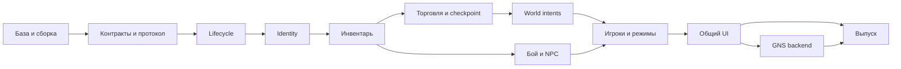

# KenshiCoop: карта изменений и план объединения

Дата исследования: 1 ноября 2026 года. Статус: исследование и план; интеграционная ветка и собранная DLL пока не созданы.

Форк: [Plesen-C/KenshiCoop](https://github.com/Plesen-C/KenshiCoop), источник: [nhoral/KenshiCoop](https://github.com/nhoral/KenshiCoop). Текущая `main` сохраняет код оригинала; здесь опубликованы план и исследовательские карты. Savas07 ниже — предлагаемая база будущей интеграции, а не уже перенесённый код.

## Решение

Предлагаемая база — **Savas07/KenshiCoop `58514ea33538fca78e932abf44bb658d4e915236`**. Она сохраняет исходный v100/ENet plugin и уже содержит многопользовательскую топологию, постоянное владение отрядами, создание персонажей, исправления торговли и сохранений. Это инженерный выбор для уменьшения одновременных архитектурных изменений, а не подтверждение стабильности этой сборки в игре.

Объединение выполняется по функциональным группам с сохранением авторства и происхождения. Текущие реализации протоколов, транспорта и правил экономики несовместимы. Для каждой полезной возможности выбирается одна реализация общего механизма; альтернативные правила игры сохраняются как согласованные режимы кампании. Повторно перенесённые и отменённые историей исправления не добавляются второй раз.

«Все изменения» в этом плане — все выявленные группы изменений активных продолжений из предыдущего месячного поиска, включая их более раннюю историю и содержательные дополнительные ветки. Старые 34 форка, не прошедшие фильтр свежего push, ранее проверялись по метаданным; полного исследования всего их кода здесь не заявляется. Совместимость сторонних модов и всех игровых версий также не установлена.

## Материалы и метод

- [Исходный список 43 форков](docs/migration/forks-2026-11-01.md).
- [Сводная карта всех 101 донорских групп с решениями и этапами](docs/migration/change-map.md), [машиночитаемая карта](docs/migration/change-map.json). Группы сведены по 25 областям; число 101 включает дубли и альтернативы, а не обозначает 101 независимую фичу.
- [Карта Savas07, ximery4, Wo-o-o и небольших форков](docs/migration/core-changes.md), [данные](docs/migration/changes-core.json).
- [Карта Brandon, TokelaCoop и atimal](docs/migration/brandon-tokela-changes.md), [данные](docs/migration/changes-tokela.json).
- [Карта kotetsyy, Vep124, Provod и альтернативы LRaverdy](docs/migration/detached-changes.md), [данные](docs/migration/changes-detached.json).
- [Зафиксированные refs, сравнение истории, совпадающие code patches и пробные слияния](docs/migration/integration-evidence.json). В JSON зафиксированы исходные SHA, область сравнения patch-id и результаты пробных слияний.

В центральное bare-хранилище загружены 82 refs: 4 ветки оригинала и 78 веток десяти продолжений. На выбранных конечных ветках выполнено сравнение stable patch-id для 420 различных non-merge коммитов по `src`, `scripts`, `third_party`, `tools`, `.github`. Это ограниченный способ находить точные совпадения патчей, а не доказательство семантической уникальности остальных коммитов. Для крупных продолжений дополнительно изучены функции и конечные деревья. Provod исследован по архиву исходников релиза, поскольку его main не содержит полного исходного дерева. Снимки и хеш архива приведены в специализированной карте.

Код доноров не запускался. Выполнены чтение исходников/истории, сравнения деревьев, проверки применения патча и `git merge-tree`. Последний пишет только объекты в исследовательское bare-хранилище и не создаёт интеграционную ветку. Сборки Windows/v100, тесты доноров и игровые сценарии в этой сессии не выполнялись.

## Дедупликация и происхождение

| Источники | Что установлено | Действие |
|---|---|---|
| nhoral → Savas07 | 73 коммита после оригинала | Сохранить итоговое состояние выбранной базы; не воспроизводить по очереди исторические изменения и их откаты |
| kotetsyy ↔ Brandon | Общий предок `c413ee03ad72ab74ac8445e6584b23537f59e0a7`, 69 общих коммитов после оригинала | Общие UI/transport/inventory improvements считать одной линией; хвост Brandon после разделения учитывать отдельно |
| TokelaCoop ↔ atimal | Общий предок `d03d6005a2bcaa6aa2fe7fde4c7e9f6b74d4acf3`, 72 общих коммита после оригинала | Учитывать общий Tokela участок один раз, затем отдельные хвосты обоих |
| ximery4 main ↔ Savas07 | Одинаковый SHA `58514ea3` | Никакого отдельного переноса main |
| ximery4 xfer-ветки | Дерево `upstream/xfer-fixture-fab` совпадает с итогом `xfer-census-source-fab` | Один источник изменения; не брать обе ветки |
| ximery4 старый trader snapshot | Отдельная история без общего предка с Savas; в ней есть дополнительная диагностика | Брать чистые `upstream/*`; уникальную диагностику портировать отдельно |
| Vep124 sync ↔ nhoral | `src/plugin/sync` совпадает после нормализации CRLF | Не переносить sync второй раз; рассматривать UI/browser/admission изменения |
| DerpyNewb ↔ nhoral | Единственная ветка указывает на августовский upstream | Новых исходников для интеграции не обнаружено |
| cookingwithsimon | Полный diff — `.gitignore` и `NOTES.md` | Сохранить полезную документацию/атрибуцию; отдельного runtime-компонента нет |
| Wo-o-o | Верхний коммит документационный, но ниже четыре исправления runtime | Переносить исправления по существу; прежнее впечатление «только документация» исправлено |
| captainjoshua77 | Изменения хранятся в `ci/fix.patch`, не применены к исходникам | Ручной перенос полезных хунков, а не merge файла патча |

Stable patch-id дополнительно выявил две группы одинаковых **code-scoped** изменений при разных SHA: `dca7736`/`94c6318` и `34f3232`/`ae9425a`. В первом случае это совпадение ограниченного версионного diff, а не всех документов коммита; во втором — включение общих host-intent helpers. Полные данные есть в evidence JSON.

## Матрица ключевых конфликтов

| Область | Конкретное расхождение | Решение интеграции |
|---|---|---|
| Packet IDs | Brandon: 50 SquadName, 51 FactionRename, 52 FactionName, 53 Jobs. Atimal: 50 ProdIntent, 51 DoorIntent, 52 FurnIntent, 53 BuildIntent, 54 fence, 55 bounty, 56 ModList, 57 StoreAdd. Savas: 52 VendorDelta, 53 VendorCash | Новый общий реестр и новая несовместимая схема. Переназначить все типы; проверить все encode/decode/dispatch ветви |
| Версия wire | Одинаковые номера версий у продолжений не означают одинаковые структуры. Provod protocol66 меняет Hello/Welcome/Money/InvItemEntry | Отдельная идентичность объединённой схемы и точная проверка fingerprint при handshake; чужие сборки отвергать до обмена состоянием |
| Инвентарь | Savas ACK/rebase, общая kotetsyy/Brandon conservation-модель, Wo complete/incomplete snapshots, atimal StoreAdd, Provod rich item identity | Один transaction/conservation pipeline, без параллельных каналов добавления одного предмета |
| Источник предмета | Atimal StoreAdd добавляет settled gain без доказанной paired source loss; ximery fixture-fab может разрешить создание из пустого world chest | Перенести сценарий/цель исправления; создание предмета разрешать только по доказанному production provenance или подтверждённой транзакции. Исходные обходы по умолчанию отключены |
| Merchant identity | Локальные ключи торговцев отличаются между машинами; ximery pairing использует description и deferred RELEASE | Общий тип merchant identity, проверка неоднозначности, session epoch, sender-scoped cleanup и срок жизни pending operations |
| NPC identity | Captain session-lifetime reverse map и Savas `canonicalOf_` с 30-секундным pruning частично перекрываются | Одна serial-validated карта wire/local identity с ясным сроком жизни, защитой rekey и смены мира |
| Combat | OWN-attacker filtering частично дублируется; Brandon stuck/unreachable mirror и Savas engaged-copy guards имеют разные условия | Один путь damage/report и одна таблица состояний движения/боя; совместить условия, не вызывать оба writer-пути |
| Мировая власть | KenshiDuo/atimal host intents, Savas host-production и cell authority, разные владельцы размещённых объектов | Единый host-authoritative world intent → validated commit → replicated result, с idempotency и явно разрешёнными owner writers |
| Экономика/дипломатия | Общий кошелёк и faction против private wallets/relations | Режим кампании `shared`/`private`, выбранный до старта; mode и schema входят в save/handshake. В сессии действует ровно один handler |
| Скорость | Разные правила арбитража, per-owner ACK, latest real command, combat cap | Явная session policy; сохранить per-owner sequencing. Смена чисел без переноса подтверждений недопустима |
| Число игроков | Tokela 2, kotetsyy/Brandon 4, Savas 8, Provod host+8 | Общая конфигурируемая ёмкость с проверкой masks/ACK/fanout; сначала доказать 2/4/8, затем режим 9 total отдельно |
| Транспорт/UI | ENet+Steam tunnel против GNS C ABI3 и native UI API4 с четырьмя DLL | Общий domain protocol поверх backend-интерфейса; GNS и новый UI переносить отдельным этапом после стабилизации логики |
| Версия Kenshi | Основная линия 1.0.65; LRaverdy — отдельная реализация для 1.0.68 | LRaverdy использовать для сравнения идей/сценариев. Его engine hooks/layouts не переносить в 1.0.65 |

Пробные прямые слияния с базой Savas дали: Brandon release — **65** конфликтующих путей (**51** в `src`); kotetsyy — **67/50**; Tokela main — **41/27**; atimal merge-kenshiduo — **46/32**; Wo — **7/6**. Это число конфликтующих путей конкретного пробного merge, включая документацию и бинарные артефакты; оно не измеряет трудоёмкость и не доказывает отсутствие семантических конфликтов в остальных файлах. Чистые ximery upstream-ветки применяются без текстовых конфликтов, но требуют исправлений ниже. Для Vep merge не выполнялся из-за несвязанной истории.

## Инварианты общего ядра

1. Каждая мутация мира имеет одного авторитетного writer; получатель применяет подтверждённый результат один раз.
2. Перемещение предмета сохраняет количество и свойства. Допустимое появление/исчезновение требует события production, purchase, consumption или другого явно описанного источника/стока.
3. Полный snapshot отличается от неполного/прерванного; отсутствие строки в неполном снимке не удаляет предмет или содержимое сумки.
4. Все pending intents, ACK, tombstones, merchant locks, identity maps и отложенные save/load операции принадлежат session/world epoch и конкретному peer; старый epoch не изменяет новый мир.
5. Неизменяемая identity игрока отделена от временного network slot; wire identity сущности отделена от локального engine hand.
6. Сохранение фиксирует согласованный checkpoint всех участвующих owners, а не только состояние хоста в момент нажатия кнопки.
7. Версия схемы, режим кампании, лимит игроков, моды и обязательные возможности согласуются до мутаций мира. Неподдерживаемая комбинация получает явный отказ.
8. Через DLL ABI передаются версионированные C-структуры и функции владения памятью. STL и объекты CRT разных toolchain через эту границу не передаются.

Это целевые контракты новой интеграции; их наличие во всех донорских реализациях не утверждается.

## Порядок реализации

Каждый этап — отдельная небольшая серия reviewable коммитов с донорскими SHA в описании. Ветка интеграции создаётся только на этапе реализации. Сторонние DLL, EXE и готовые kit-каталоги не разрешают конфликт исходников: все итоговые артефакты пересобираются из объединённого дерева.

| Этап | Результат и источники | Зависит от | Условие завершения |
|---|---|---|---|
| **P0. Воспроизводимая база** | Зафиксировать Savas585, engine 1.0.65, KenshiLib/RE_Kenshi/toolchain. Восстановить актуальные инструкции. Разделить source и generated kits; перенести нужные fixtures/атрибуцию | — | Чистые Release и Harness сборки v100; сохранён baseline всех доступных тестов и двухклиентного сценария |
| **P1. Общие контракты** | Реестр packet IDs/layouts, схема handshake/fingerprint, session/world epoch, player/entity IDs, единые intent/ACK/revision правила, campaign policy descriptor | P0 | Golden wire tests, проверки размеров/границ, отказ всем старым протоколам и несовместимым режимам до применения данных |
| **P2. Lifecycle и аварийные пути** | Wo `1125031`: send abort, receive cancel, stale save/load cleanup. Сохранить Savas CRC/path/atomic recovery; адаптировать abort на несколько получателей. Tokela Steam shutdown hook останавливает сетевой поток до SteamAPI_Shutdown; callback приглашения исправить 533→333 | P1 | Disconnect одного join не прерывает чужой transfer; partial save не становится live; повторный вход/смена мира не применяют старую работу; выход при живом соединении и Steam invitation работают |
| **P3. Entity и merchant identity** | Captain reverse map/door translation; сохранить Savas stable identity/recruit guards. Ximery trader descriptor pairing с обязательным reset всех кешей и sender/epoch tagging | P1–P2 | Rekey/unload/reload через >30 секунд; два одинаковых торговца; смена мира с parked RELEASE; leave/rejoin; отсутствие старых или неверно сопоставленных операций |
| **P4. Инвентарь как транзакции** | Совместить Wo complete/graph-safe snapshots/ACK latch, общую kotetsyy–Brandon conservation/cursor-reservation модель и Savas source-shortfall rejection. Сохранить Savas bag creation grace и allowContainerCreate/outContainerShort. Добавить уникальные Wo receive tombstones, nofac-aware ownership filter и ранний peer-owner check. Перенести свойства предметов Provod: charges/unique/owner | P1–P3 | Конкурентное взятие из сундука/трупа, delayed ACK, partial/reordered snapshots, сумка в сумке, экипировка и cursor transfer не создают/не теряют предметы; сохраняются grade/charges/ownership; replay world-item не воскрешает consumed proxy |
| **P5. Торговля, production и checkpoint** | Объединить Savas vendor lock/cash и Provod vendor64/quote сценарии с общим transaction API. Перенести KenshiDuo/atimal save fence и kotetsyy staged checkpoint. Решить first-take fixture проблему без неограниченного fabrication | P4 | Два гостя торгуют с одним merchant; повторная сделка не зависает; guest chest deposit и mining переживают save/reload; save во время транзакции ждёт её commit/rollback |
| **P6. Мировые intents** | Atimal/KenshiDuo doors/locks, furniture, construction, production, bounty; captain standalone doors; kotetsyy lock revisions и camp-bed reconciliation; сохранить Savas single production writer | P3–P5 | Повтор/перестановка intent не дублируют объект; join строит/разбирает/пользуется мебелью; обычный сундук не попадает под merchant layout; повторные locks не откатывают новую revision |
| **P7. Бой, движение и NPC** | Совместить Savas engaged-copy/carry/recruit authority с Brandon OWN-hit и stuck-hostile mirror, Tokela limb/dismiss fixes. Atimal medical negative-flesh/bandage overlay и Provod signed treatment masks переносить одной медицинской схемой. Internet-smoothing — настраиваемая политика после проверки authority | P3–P4, для world interactions P6 | Один hit учитывается один раз; бои в общей/разных зонах, split/rejoin squad, carry, dead/rekeyed NPC и unreachable attacker сходятся без двух writer-путей; отрицательные HP и частичное лечение не теряются |
| **P8. Игроки и режимы кампании** | Сохранить Savas chargen/Steam roster; свести Tokela ledger/own-guard и Provod private squads/wallets/relations/sidecars. Squad names, faction names и jobs Savas/Brandon перенести одной схемой. Разные speed policies оформить явно | P1–P7 | Матрица 2/4/8, затем 9 total; peer departure, reconnect, slot reuse, absent owner substitution; shared/private save roundtrip; выбранные правила согласованы у всех |
| **P9. Интерфейс и подключение** | Vep Steam/LAN browser и admission/password; Tokela lobby callbacks/modlist/refusal/update/play-again; Savas lobby/chargen; общая kotetsyy–Brandon native UI/Unicode — поверх единого controller API | P1–P8 | Host/join из меню, приглашения, отказ при несовпадении модов/схемы/режима, reconnect и Unicode; UI не обходит state machine или owner validation |
| **P10. Альтернативный транспорт** | Выделить backend interface. Перенести GNS C ABI3 и native UI API4 из общей kotetsyy/Brandon линии с контролем версии и зависимостей; сохранить рабочий ENet backend | P1, P8–P9 | Одинаковые domain scenarios поверх каждого backend; проверены DLL exports/CRT ownership, loss/latency/disconnect и shutdown; бинарники пересобраны согласованным toolchain |
| **P11. Инструменты и выпуск** | Свести Wo portable CI, Savas devkit/replay, донорские regression oracles, Ximery `9eedc08` lastAddItemsFailReason/fabWhy, Brandon friend installer, Tokela one-click/workshop, Provod launcher/source packaging. Опубликовать актуальную карту источников | P0–P10 | Все обязательные gates выполнены, сценарии экспортированы в отчёт; установка/обновление/откат на чистой игре; исполняемые файлы соответствуют опубликованным исходникам |

Проверки внутри этапов добавляются рядом с поведением, а не откладываются до P11. P11 объединяет матрицу и упаковку. P9 и часть инструментов можно разрабатывать параллельно после стабилизации их API. P10 не является зависимостью исправлений сохранений, инвентаря или боя.

Дополнительные небольшие возможности не теряются в крупных этапах: A08 из карты Tokela/atimal включает portraits, имена персонажей и возраст животных, assassination, chase anchors, cage break и carried healing — их перенос привязан к P4/P6/P7/P8 в сводной карте. P5 включает READY/load barrier, сохранение пользовательской паузы, save backlog/backpressure и bounded miniz compression: проверять compressed/raw размеры, точное соответствие распакованного размера и предел 512 MB, сохраняя atomic staging. P8 включает dismiss→NPC→wander, chat/display names и миграции ownership sidecars. P11 включает четырёхкомпонентный manifest/hash/rollback updater Kotetsyy; адреса чужих updater/release endpoints заменяются адресами будущего объединённого проекта.

Подтверждённая независимой проверкой небольшая правка: в Savas585 `SteamInvite.cpp` всё ещё использует `k_iSteamMatchmakingCallbacks + 33` (533) для GameLobbyJoinRequested. Исправление Tokela `ad979ac` на Friends callback 333 не является уже включённым дублем. При переносе сверить callback ABI с выбранными Steam headers.

## Обязательные корректировки донорских патчей

- **Ximery trader** (`88f0dd9`, `13931f2`): новые `tradePeerKey_`, `tradeDesc_`, `tradePark_`, `tradeMissLog_` не очищаются в исходном `resetSession`/peer cleanup. Перед включением добавить reset, peer cleanup, epoch и тест delayed RELEASE после перехода в другой мир. Это результат статического анализа, не воспроизведённый здесь игровой сбой.
- **Ximery fixture fabrication** (`5f89ce8`): исключение corpses/owned inventories не доказывает корректность создания предмета из любого type-0 census fixture. Обычный world chest тоже подходит под условие. Сохранить консервативный отказ Savas `3244070`; допускать восстановление только с доказанным источником/transaction token. До этого альтернативный код — default-off experimental.
- **Atimal StoreAdd**: sender/key/qty validation не заменяет paired source-loss proof. Перенести сценарий guest chest deposit в общий conserved intent, а не оставлять второй независимый add-to-container handler.
- **Atimal merchant port**: перенос `4f695f0` требует последующего ограничения `b920e9e`: exact merchant layout только для подходящего shop shelf, иначе обычные сундуки показываются пустыми. Переносить конечное исправленное поведение.
- **Captain reverse map**: Savas identity helpers дают частичное перекрытие, но `canonicalOf_` удаляется после grace. Проверить срок жизни карты, serial reuse, entity destruction, peer leave и смену мира; сохранять старые mappings бесконечно тоже нельзя.
- **Wo save abort**: двухигроковая реализация не может без изменений отменять многополучательную передачу Savas. Cleanup должен быть адресным.
- **Kotetsyy money ACK**: его N-player broadcast total с `ackSeq=0` не заменяет Savas per-owner ACK/pending reapply. В общий контракт перенести полезные правила арбитража, сохранив последовательность подтверждений.
- **Provod canonical files**: `CanonicalWire.h`/`CanonicalTransport.h` являются экспериментальной инфраструктурой и не подключены к live NetLink. Их нельзя принять за уже работающую замену транспорта.
- **Kotetsyy environment items**: соответствующий код отключён в public Release и требует harness flag; переносить как эксперимент с отдельными gates. Procedural camp beds — отдельная активная подсистема.

## Приёмочная матрица

| Измерение | Обязательные варианты |
|---|---|
| Сборки | Настоящий v100 Release и Harness; UI/transport DLL с проверенной C ABI границей; portable unit tests отдельно |
| Игроки | 2, 4, 8; host+8 как отдельный расширенный режим; выход и возвращение разных slots |
| Транспорт | ENet direct/LAN, Steam tunnel; GNS direct/P2P после P10 |
| Сеть | Задержка 0/100/300 ms, потери 0/1/5%, duplicate/reorder на test transport, disconnect на каждой стадии save/transaction |
| Мир | Общая зона, разные зоны, длинный переход, town unload/reload, host/join starts и chargen, recruitment/dismiss/death |
| Предметы | Chest/corpse/vendor/production, nested bags, экипировка, stack/grade/charges/owner, одновременное взятие, save на границе ACK |
| Политики | Shared/private campaign; каждый поддержанный speed policy отдельно; невозможные комбинации отвергаются handshake |
| Lifecycle | Смена мира при pending trade, save abort, повторный join, смена slot, >30 s grace, повторная загрузка того же save |
| Установка | Чистая установка, обновление, отсутствие зависимой DLL, protocol/mod mismatch, rollback с резервной копией сохранения |

Числа задержки/потерь — предложенная начальная тестовая матрица, а не измеренные характеристики продукта. Для item tests проверять conservation до и после reload, не только факт наличия предмета на одном экране. Для критичных regressions тест обязан отличать старый дефектный путь от исправленного; зелёный mock сам по себе не подтверждает engine ABI.

## Критерий полноты объединения

У каждой записи исходных карт должна быть конечная отметка: **included-base**, **ported**, **equivalent-existing**, **optional-policy/backend**, **reimplemented-for-invariant**, **docs/tooling**, либо **experimental-with-explicit-gate**. Для ported и reimplemented указываются новый commit, донорские SHA, тест и результат. Временный deferred допустим для планирования, но не для объявления задачи полного объединения завершённой. Ошибочные промежуточные состояния и исторические откаты сохраняются в provenance, а не включаются в runtime одновременно.

Первый полезный результат реализации — Savas585 с исправленной очисткой сессии/сохранений и identity, затем conserved inventory/vendor checkpoint. Расширенные игровые режимы и GNS добавляются после этих контрактов. Это позволяет проверять каждую порцию отдельно и сохранять все полезные возможности без одновременного ввода несовместимых writer-путей.
